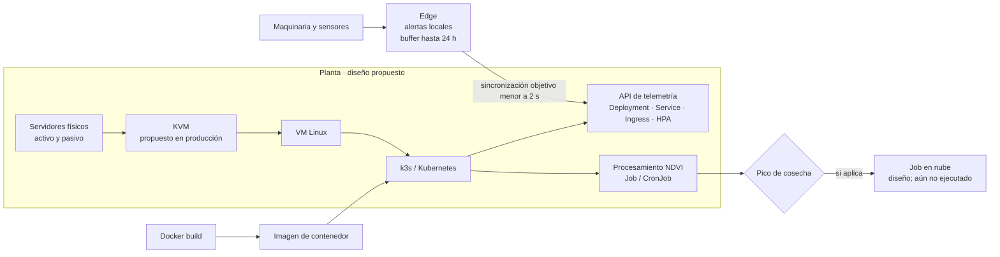

# AgroSugar-IoT

**Proyecto Integrador · Arquitectura de Sistemas Computacionales · UNIAJC**  
Caso: monitoreo de cultivo de caña de azúcar con Edge, contenedores y Kubernetes.

[Informe Avance 2](docs/informe-avance2.docx) · [Corte 3 / Sesión 12](corte-3/sesion-12/README.md) · [Gestión ágil propuesta](gestion-agil/README.md) · [Evidencias](evidence/README.md)

> **Estado:** repositorio académico con diseño, ejemplos de código y resultados de laboratorio. Las capacidades de producción descritas son propuestas; se indican las pruebas que siguen pendientes.

## Arquitectura propuesta



El diseño mantiene las alertas críticas en Edge, con una meta menor a 100 ms. Kubernetes administra los servicios y los lotes; no está en el camino de control crítico. El diagrama representa la arquitectura propuesta, no un despliegue integral probado.

## Estado de las capacidades

| Área | Evidencia disponible | Límite actual |
|---|---|---|
| Docker | Construcción y ejecución de `telemetry-api`; límites visibles con `docker stats` y cgroups. | El código del repositorio reproduce las rutas observadas, pero no se recibió el código fuente original de la imagen capturada. |
| Kubernetes | Capturas de Pods, auto-sanación y eventos de HPA en k3s de un nodo. | Los manifiestos actuales aún requieren ejecución y captura conjunta de Ingress, PVC y CronJob. |
| Virtualización | `virsh`, QEMU y discos qcow2 thin. | Las VM del laboratorio fueron emuladas con QEMU; KVM acelerado y EPT no se demostraron. |
| Trazabilidad y resiliencia | Salidas de simulación OpenTelemetry, Circuit Breaker, Bulkhead y backoff/jitter. | Las simulaciones no son mediciones de producción; el ejemplo UCI corresponde a HospitValle. |
| NDVI y nube | Manifiestos de ejemplo para Job/CronJob y una base de Cloud Bursting. | El worker usa datos numéricos de muestra; no procesa imágenes reales ni ejecuta bursting a una nube. |
| SLA y energía | Cálculos de disponibilidad, PUE y costos documentados. | PUE y costos están basados en supuestos; falta medirlos con datos reales. |

## Recorrido del repositorio

| Carpeta | Contenido |
|---|---|
| `app/`, `worker/` | API y worker de ejemplo con Dockerfiles. |
| `k8s/`, `k8s-nube/` | Manifiestos de Kubernetes local y demostración de Job en nube. |
| `virtualization/`, `scripts/` | Diagnósticos y scripts de captura/operación. |
| `evidence/` | Capturas de Docker, Kubernetes y virtualización, con notas de alcance. |
| `docs/` | Informe técnico de Avance 2. |
| `corte-3/sesion-12/` | Ejercicios de trazabilidad, resiliencia y backoff/jitter. |
| `gestion-agil/` | Visión, backlog, plan de sprints y criterios de terminado propuestos. |

## Inicio rápido · API de ejemplo

Desde la raíz del repositorio:

```bash
docker build -t agrosugar/telemetry-api:1.0.0 ./app
docker run --rm -p 8080:8080 agrosugar/telemetry-api:1.0.0
curl -i http://localhost:8080/health/live
```

Para Kubernetes, revisa primero [`k8s/README.md`](k8s/README.md): k3s usa su propio runtime de contenedores, por lo que la imagen debe estar cargada en el nodo o publicada en un registry accesible. Los comandos de laboratorio y de Cloud Bursting requieren el entorno correspondiente; consulta sus README antes de ejecutarlos.

## Cómo se organiza el trabajo

La carpeta [`gestion-agil/`](gestion-agil/README.md) contiene una propuesta Scrum basada en los entregables y evidencias actuales. No es un registro histórico de ceremonias celebradas ni de roles ya asignados. Los cambios pueden incorporarse con historias de usuario, criterios de aceptación y evidencia enlazada desde GitHub Issues.


## Referencias

- [Guía de entrega de Avance 2](guia-avance2-proyecto-integrador-abpr.pdf)
- [Informe técnico de Avance 2](docs/informe-avance2.docx)
- [Guía Scrum oficial en español](https://scrumguides.org/docs/scrumguide/v2020/2020-Scrum-Guide-Spanish-Latin-South-American.pdf)
